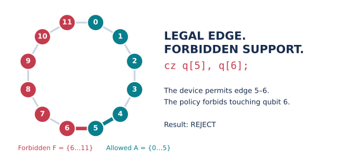
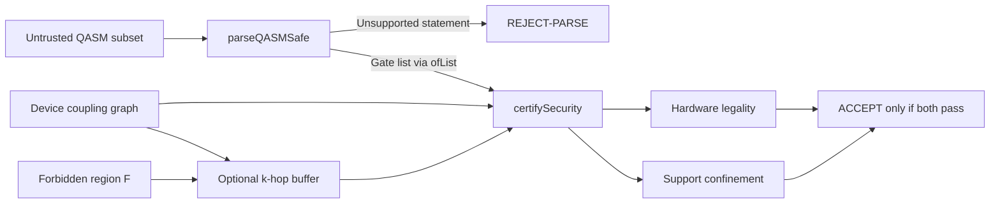
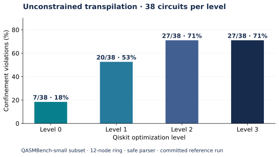

# Certified Qubit Confinement

**Lean 4–verified confinement checks for quantum-cloud circuits.**

This repository is the research artifact for the **ACM PQQS ’26 paper submission**
[**Certified Confinement: Kernel-Checked Validation of Untrusted Quantum-Cloud Transpiler Output**](https://dl.acm.org/doi/10.1145/3839338.3857240),
by Ali Hamza Malik and Muhammad Taqi Raza.

[Quick start](#quick-start) · [How it works](#how-it-works) · [Results](#results-and-evidence) · [Setup](docs/SETUP.md) · [Reproduction guide](docs/USAGE.md) · [Paper → code](docs/PAPER.md)

A quantum circuit can obey every device connectivity rule and still touch another
tenant’s qubits. This research artifact validates untrusted transpiler output
against both the device graph and a tenant-defined forbidden region, with a
soundness theorem checked by the Lean kernel.



*Drawn from [sample 02](examples/02_cotenant_touch.qasm), the
[`heavyHex` ring](QpuCompiler/CompileHH.lean), and
[`tenantF` policy](QpuCompiler/Confine.lean). Despite its historical name,
`heavyHex` is a 12-node cycle; the repository also includes real device topologies.*

## Quick start

With [Lean / elan](docs/SETUP.md) and Python installed, run from the repository root:

```bash
git clone https://github.com/alirafiqmalik/certified-confinement-acm-pqqs-26-artifacts.git
cd certified-confinement-acm-pqqs-26-artifacts
bash setup.sh
lake build
bash run_artifact.sh --core-only
```

The core run checks **9 stages**: proofs, axiom dependencies, device topologies,
sample verdicts, timing, simulation, and reconciliation of the published hardware
counts. It needs no IBM account or QPU access. Initial setup downloads dependencies;
the first Lean build can take 30 minutes or more. Subsequent runs reuse the build.

Read `artifact-run/SUMMARY.md` for the outcome and `artifact-run/logs/` for details.
To also reproduce the external benchmark tier:

```bash
bash run_artifact.sh --fetch-benchmarks
```

This downloads QASMBench. The default runner also retrieves IBM job records when
an account configuration exists; `--core-only` skips that tier. New QPU jobs require
an explicit `--submit-qpu` flag. See [all stages and options](docs/USAGE.md).

## A circuit that is legal—and rejected

The executable statements in [sample 02](examples/02_cotenant_touch.qasm) are:

```qasm
x q[0];
cz q[4], q[5];
cz q[5], q[6];
```

Edge `5–6` exists in the device graph, but qubit `6` lies in the forbidden region
`F = {6, …, 11}`. Run all four examples after building:

```bash
.venv/bin/python harness/certify_qasm.py --samples
```

```text
ACCEPT  examples/01_ok_confined.qasm    (gates=7 legal=true  confined=true)
REJECT  examples/02_cotenant_touch.qasm (gates=3 legal=true  confined=false)
REJECT  examples/03_illegal_edge.qasm   (gates=2 legal=false confined=false)
ACCEPT  examples/04_ok_ring_chain.qasm  (gates=8 legal=true  confined=true)
```

The sample driver uses a fixed 12-node ring and partition. The underlying Lean
validator is parameterized by the device graph and forbidden region.

## How it works



The [front end](QpuCompiler/Frontend.lean) conservatively rejects unsupported
support-bearing statements. The [validator](QpuCompiler/Confine.lean) checks
hardware legality and that no non-identity gate touches the forbidden region.
[Buffered policies](QpuCompiler/Buffer.lean) expand that region by `k` graph hops
before applying the same check. Validation does not simulate quantum states.

The central theorem, directly from [Confine.lean](QpuCompiler/Confine.lean):

```lean
theorem certifySecurity_sound {n : ℕ} (g : Coupling n) (F : ℕ → Bool) (ext : UCom n)
    (h : (certifySecurity g F ext).accepted = true) :
    HWF g ext ∧ confinedb (fun x => !F x) ext = true := by
  simp only [CertResult.accepted, certifySecurity, Bool.and_eq_true, decide_eq_true_eq] at h
  exact h
```

An accepted result entails both predicates for the represented circuit.
The theorem uses only `propext`; the runner checks its axiom dependencies.
The repository also proves properties of its own routing and optimization pipeline;
see the [claim-to-symbol map](docs/PAPER.md).

## Results and evidence



*Generated from [the committed safe-parser results](harness/benchmarks/e5_results.json).
Each level uses 38 circuits from the QASMBench-small subset that fits the 12-node
ring. Parse rejections are separate from confinement violations. These are results
for this experimental configuration, not a general rate across quantum workloads.*

| Evidence | Recorded result | Inspect or reproduce |
|---|---|---|
| Device coverage | 11 topologies; 44 independently recomputed verdicts | [Corpus](harness/devices/DEVICE-CORPUS.md) · stage A4 |
| Sample circuits | 2 accepted, 2 rejected | [Examples](examples/) · stage A5 |
| Offline regression | 9 tests | [Test suite](harness/sim/test_e2e.py) · stage A7 |
| Hardware audit | 8/8 sweep and 8/8 repeat cells reproduce from raw counts | [Provenance](harness/ibm-hardware/PROVENANCE.md) · stage A9 |
| Transpiler evaluation | 7/38, 20/38, 27/38, 27/38 confinement violations | [Analysis](harness/axis2-results/optlevel-results.md) · stages B1–B2 |
| Front-end fuzzing | 1,120 mutants; 269 false accepts with the old parser, 0 with the safe parser | [Data](harness/benchmarks/fuzz_results.json) · stages B3–B4 |
| Buffered allocation | 0 confinement false rejects in the recorded allocation sweep | [Data](harness/benchmarks/buffered_alloc_results.json) · stage B6 |

The repository keeps published evidence under `harness/`; reproduction outputs go
to the ignored `artifact-run/` directory. Live hardware submission backs up the
published records before replacing them.

## Repository map

```text
QpuCompiler/              Lean semantics, routing, confinement, and proofs
QpuCompiler.lean          public library imports
examples/                 four OpenQASM circuits with known verdicts
harness/
  CertifyQASMSafe.lean     safe-parser executable
  certify_qasm.py         sample and file-validation driver
  benchmarks/             benchmark and fuzz scripts, reference data
  axis2-results/          benchmark reports and verdict records
  devices/                real device corpus and independent verification
  sim/                    offline model, regression suite, blind predictions
  ibm-hardware/           hardware workflows, measurements, provenance
docs/                     setup, reproduction, and paper-to-code guides
  assets/                 generated README figures
scripts/                  figure regeneration
run_artifact.sh           staged reproduction entry point
setup.sh                  Python environment setup
```

[Layout and maintenance guide](docs/STRUCTURE.md) explains directory ownership,
path changes, and how to regenerate the figures.

## Scope and interpretation

- **Structural guarantee.** Acceptance proves hardware legality and support
  confinement for the represented circuit. It does not bound physical crosstalk.
- **Restricted input language.** The driver handles an OpenQASM subset, not the
  complete language. The old parser is retained as an experimental counterexample.
- **Empirical hardware evidence.** Measurements motivate the policy; they are not
  part of the mathematical proof. The simulator injects a ZZ interaction, and its
  fitted-model agreement is a self-consistency check.
- **Reproduction boundaries.** Lean and Mathlib are pinned; Python dependencies
  are currently unpinned. Fresh benchmark timings and results can vary by environment.

For a specific claim, start with [Paper → code](docs/PAPER.md). For reproduction
help, use the [setup guide](docs/SETUP.md) and [stage reference](docs/USAGE.md).
Report issues with the command, toolchain versions, and relevant stage log in
[GitHub Issues](https://github.com/alirafiqmalik/certified-confinement-acm-pqqs-26-artifacts/issues).

## Citation

If you use this artifact, please cite the accompanying paper:

Ali Hamza Malik and Muhammad Taqi Raza. 2026. **Certified Confinement:
Kernel-Checked Validation of Untrusted Quantum-Cloud Transpiler Output.**
In *Proceedings of the 2026 ACM Conference on Post-Quantum and Quantum-based
Security* (PQQS ’26). ACM, New York, NY, USA, 106–121.
[https://doi.org/10.1145/3839338.3857240](https://doi.org/10.1145/3839338.3857240).

```bibtex
@inproceedings{malik2026certifiedconfinement,
  author    = {Malik, Ali Hamza and Raza, Muhammad Taqi},
  title     = {Certified Confinement: Kernel-Checked Validation of Untrusted Quantum-Cloud Transpiler Output},
  booktitle = {Proceedings of the 2026 ACM Conference on Post-Quantum and Quantum-based Security},
  series    = {PQQS '26},
  year      = {2026},
  pages     = {106--121},
  publisher = {ACM},
  address   = {New York, NY, USA},
  doi       = {10.1145/3839338.3857240},
  url       = {https://doi.org/10.1145/3839338.3857240}
}
```
